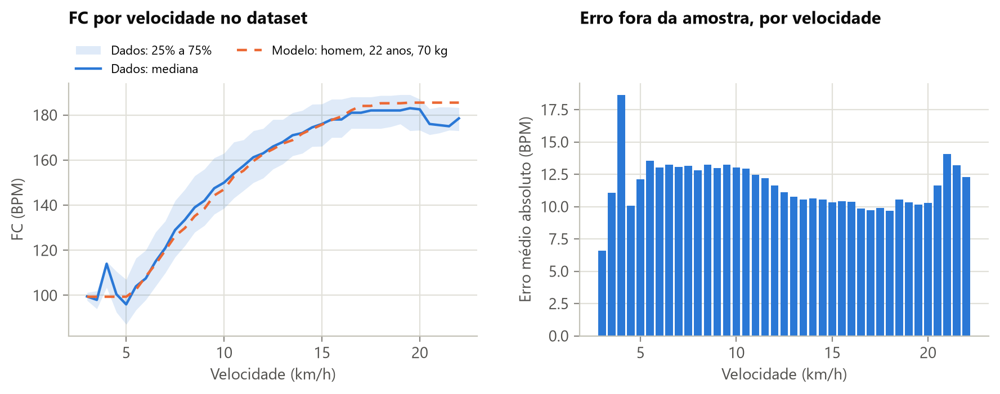
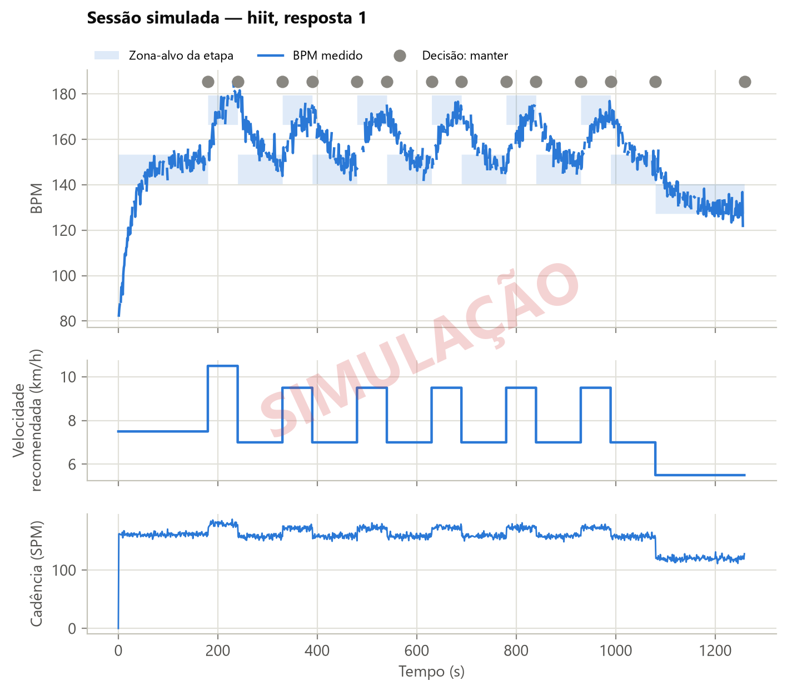
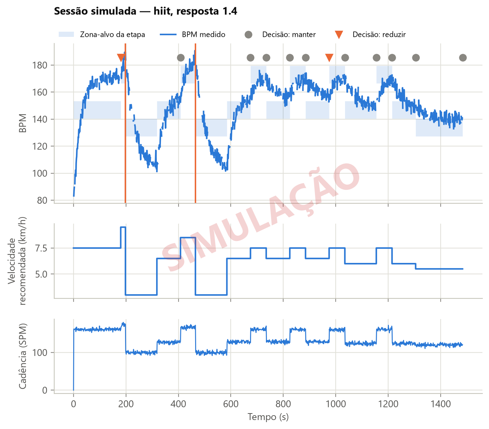
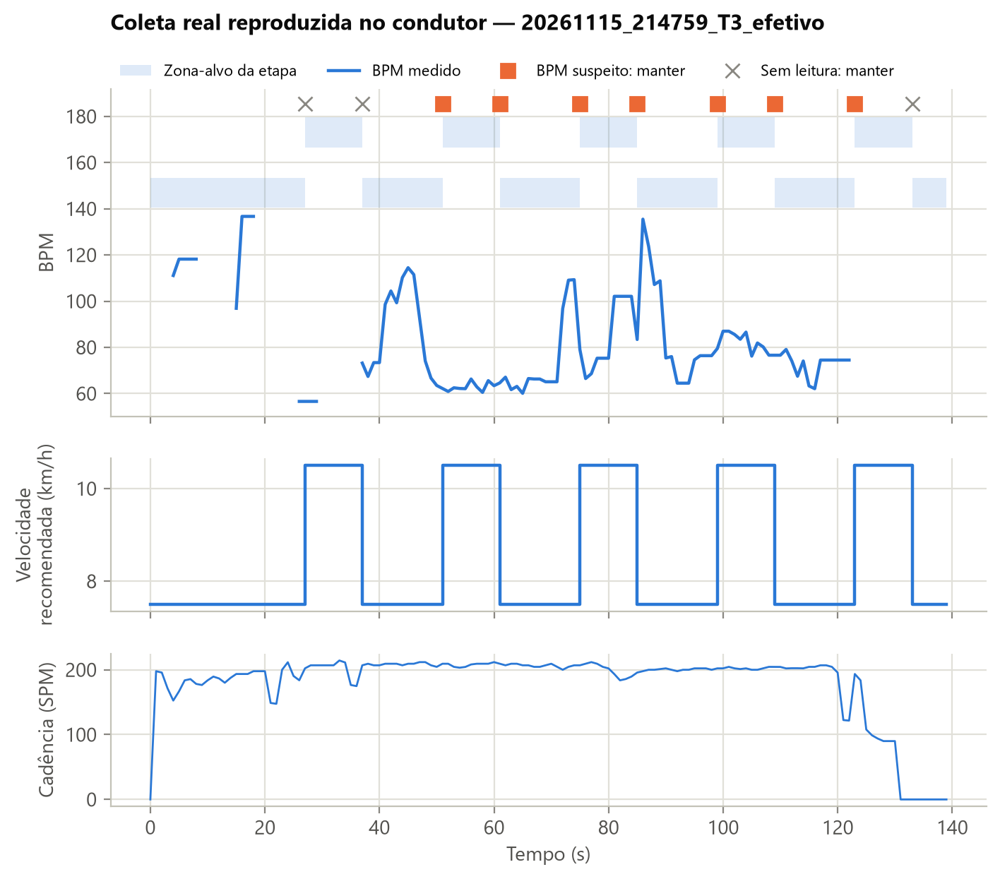

# GCP-Esteira — Entrega V2: análise de dados, IA, tomada de decisão e documentação cumulativa

Universidade Federal do Ceará — Departamento de Engenharia de Teleinformática — Engenharia de Computação — Internet das Coisas

Klaiver Santos Diogo, Lucas Ferreira da Rocha e Leonardo Máximo Viana

> **Como usar este arquivo.** É o texto do relatório da V2, cumulativo: resume a V0 e a V1 e acrescenta o que é novo. Os trechos marcados com **[PREENCHER]** dependem da equipe. Apague este aviso ao final.

## Histórico de revisões

| Data | Versão | Descrição | Responsável |
|---|---|---|---|
| 08/09 | 1 | Descrição informal e requisitos (V0) | Lucas Ferreira |
| 15/11 | 2 | Coleta de dados, comunicação MQTT e documentação inicial (V1) | **[PREENCHER]** |
| **[PREENCHER]** | 3 | Guia de cardio: análise de dados, modelo treinado e tomada de decisão (V2) | **[PREENCHER]** |

## 1 Objetivo da entrega

A V1 mostrou o sistema medindo e transmitindo. A V2 usa essas medições para **decidir**: o usuário escolhe um tipo de treino e o sistema monta a sessão, mostra no painel a velocidade e a duração de cada etapa e ajusta as etapas seguintes conforme a frequência cardíaca (FC) e a cadência medidas.

Requisitos da V0 tratados aqui: RF03 (instruções de treino), RF04 (tempo de etapa e métricas no visor), RF06 (plano de treino vindo da nuvem) e RF07 (sinalização de segurança).

## 2 Resumo cumulativo das entregas anteriores

- **V0:** descrição da aplicação e requisitos (arquivo `Entrega v0 ... .pdf`).
- **V1 (`docs/relatorio_v1.md`):** braçadeira (ESP32, MAX30102, acelerômetro MMA8453Q) envia BPM, SPM e passos por ESP-NOW a 10 Hz ao painel (ESP32, TFT ST7789), que publica no ThingsBoard por MQTT a 1 Hz.

Resultados da V1 que condicionam a V2:

| Medida | Resultado | Efeito no projeto da V2 |
|---|---|---|
| Enlace ESP-NOW (T3, 140 s) | 0% de perda, latência mediana de cerca de 2 ms | A comunicação não limita o guia |
| MQTT (T3) | 140 de 140 publicações | Idem |
| Passos (T2 a 140 e 170 SPM; T3) | −1,4%, +5,3% e 0% frente à contagem manual | A cadência é confiável em trote e corrida |
| Passos (T2 a 100 SPM) | −36% | A cadência não é confiável em caminhada lenta |
| BPM (T1 e T3) | Erro médio absoluto de 9 a 16 BPM; leitura válida em 50 a 99% do tempo | O BPM não pode ser usado sem verificações |

A equipe decidiu não recalibrar os sensores nesta entrega. Por isso a V2 trata o BPM como um sinal pouco confiável e inclui regras que impedem decisões baseadas em leituras ruins (seção 5.3).

## 3 Arquitetura da V2

```
Braçadeira --ESP-NOW--> Painel --MQTT--> ThingsBoard <--REST--> Serviço guia/ (Python, no PC)
                          ^                   |
                          +---- RPC definirEtapa / encerrarTreino
```

| Componente | O que mudou na V2 |
|---|---|
| `guia/nucleo.py` | Zonas de FC, tipos de treino, modelo FC-velocidade e condutor (regras de decisão) |
| `guia/treinar_modelo.py` | Treino e avaliação do modelo com dataset público |
| `guia/executar.py` | Modos `plano`, `simular`, `reproduzir` (coleta gravada) e `ao-vivo` (ThingsBoard) |
| `receptora/receptora.ino` | Tela de treino e comandos RPC `definirEtapa` e `encerrarTreino`; telemetria `etapa` e `vel_alvo` |
| Braçadeira | Sem mudanças |

O serviço lê a telemetria mais recente do ThingsBoard uma vez por segundo, passa a leitura ao condutor e, a cada troca de etapa, envia ao painel um RPC com nome, velocidade, duração e faixa de BPM. As decisões também são gravadas como telemetria (`guia_etapa`, `guia_vel`, `guia_situacao`, `guia_evento`), para ficarem no histórico da nuvem.

O sistema não mede nem controla a esteira. A velocidade é uma **recomendação**: o usuário ajusta a esteira, e a cadência serve para conferir se o ritmo corresponde ao pedido.

**Tela de treino do painel.** A barra de título mostra a etapa e sua posição (`TIRO 4/14`). O quadro de BPM mostra a faixa-alvo e muda a cor da moldura: verde na zona, amarelo abaixo, vermelho acima, cinza sem leitura. O segundo quadro mostra a velocidade recomendada e o tempo restante (`9.5km/h 0:45`), com cadência e passos embaixo. Em uma etapa de alerta, a barra de título fica vermelha. **[PREENCHER: foto do painel na tela de treino.]**

## 4 Análise de dados e modelo

### 4.1 Zonas de frequência cardíaca

A FC máxima é estimada pela fórmula de Tanaka (208 − 0,7 × idade). As cinco zonas usam a reserva de FC (método de Karvonen): a zona *k* vai de (40 + 10*k*)% a (50 + 10*k*)% da reserva, somada à FC de repouso. Para 22 anos e 62 BPM em repouso, a FC máxima estimada é 193 BPM e as zonas são 127–140, 140–153, 153–166, 166–180 e 180–193 BPM.

### 4.2 Dataset

*Treadmill Maximal Exercise Tests from the Exercise Physiology and Human Performance Lab of the University of Malaga* (PhysioNet, versão 1.0.1): 992 testes incrementais em esteira, de 857 pessoas, com velocidade, FC, idade, sexo, peso e altura. O acesso é aberto, mas a licença não permite redistribuir os dados; eles ficam em `dados/externos/`, fora do repositório.

Preparação feita em `guia/treinar_modelo.py`:

1. descarte de leituras fora de 40–220 BPM e de 3–22 km/h;
2. uso apenas da fase de esforço de cada teste, até a velocidade máxima, porque na recuperação a FC continua alta com a velocidade baixa;
3. resumo de cada teste a uma linha por velocidade (mediana da FC a cada 0,5 km/h).

O resultado tem 20 098 linhas (teste × velocidade).

### 4.3 Modelo

O modelo prevê a FC a partir de velocidade, idade, sexo, peso e altura. Foram comparados dois modelos e uma referência sem aprendizado, com validação cruzada em 5 partes agrupada por pessoa (ninguém aparece no treino e no teste ao mesmo tempo):

| Modelo | Erro médio absoluto | R² |
|---|---|---|
| Referência: mediana da FC em cada velocidade | 12,4 BPM | 0,720 |
| Regressão linear | 12,6 BPM | 0,707 |
| Gradient boosting com FC não decrescente na velocidade (escolhido) | 12,0 BPM | 0,728 |



**Leitura do resultado.** O modelo escolhido é só 0,4 BPM melhor que a referência. Idade, sexo, peso e altura explicam pouco: a maior parte do erro de cerca de 12 BPM é a diferença entre pessoas, que esses atributos não capturam. A conclusão prática é que um modelo populacional serve como ponto de partida, e a decisão durante a sessão precisa corrigi-lo para cada usuário.

**Limitações do dataset para este uso.** Os testes são incrementais (a velocidade sobe continuamente) e os participantes são, em geral, pessoas treinadas. Nos dois casos a FC registrada em uma velocidade é menor do que a de um usuário comum mantendo essa velocidade. Sem correção, o modelo recomendaria 10 km/h para um aquecimento na zona 2. Por isso:

- o guia parte de uma **margem de 20 BPM** somada à previsão (cerca de 1,7 vez o erro do modelo), o que reduz as velocidades iniciais (zona 2 a 7,5 km/h no mesmo exemplo);
- a margem pode ser substituída por uma **calibração** com uma medida do próprio usuário (`--calibracao 6:118` = 118 BPM estáveis a 6 km/h);
- ao fim de cada etapa, metade do erro observado entra em um deslocamento pessoal do modelo.

### 4.4 Atividade pela cadência

A atividade é classificada por regras sobre o SPM: parado (< 40), caminhada (< 130), trote (< 165) e corrida. A atividade esperada vem da velocidade recomendada (caminhada até 6,5 km/h, trote até 9 km/h, corrida acima). Os limiares são valores iniciais e não foram validados com dados próprios.

## 5 Tomada de decisão

### 5.1 Tipos de treino

| Treino | Etapas (zona, duração) |
|---|---|
| `hiit` | aquecer (Z2, 3 min); 6 × [tiro (Z4, 1 min) + recuperar (Z2, 1,5 min)]; desaquecer (Z1, 3 min) |
| `continuo` | aquecer (Z1, 3 min); ritmo (Z3, 20 min); desaquecer (Z1, 3 min) |
| `progressivo` | Z1 3 min; Z2 5 min; Z3 5 min; Z4 3 min; Z1 3 min |
| `recuperacao` | Z1, 15 min |

O gerador converte cada zona em velocidade com o modelo da seção 4.3, em múltiplos de 0,5 km/h, entre 3 km/h e o teto informado pelo usuário.

### 5.2 Regras ao fim de cada etapa

O condutor usa a mediana do BPM válido na segunda metade da etapa, quando a FC já respondeu à velocidade.

| Condição | Decisão |
|---|---|
| Menos de 50% de leituras válidas | Mantém o plano e registra a falta de dados |
| Mediana mais de 5 BPM acima da zona | Reduz 0,5 km/h nas próximas etapas dessa zona; se era uma recuperação, alonga a próxima em 30 s |
| Mediana mais de 5 BPM abaixo da zona | Aumenta 0,5 km/h, até o teto |
| Dentro da zona | Mantém |

A correção acumulada por zona é limitada a ±2 km/h.

### 5.3 Regras de segurança

- **Alerta de FC (RF07).** Se a mediana dos últimos 10 s passa de 95% da FC máxima estimada, a etapa é interrompida, entra uma recuperação de 2 min a 3 km/h com a barra do painel em vermelho, e a zona interrompida e as superiores ficam 1 km/h mais lentas.
- **Leitura suspeita.** Se a cadência indica trote ou corrida e a mediana do BPM está mais de 15 BPM abaixo da zona 1, a leitura é descartada e o plano é mantido. Essa regra veio dos dados reais da V1 (seção 6.3).
- **Ritmo abaixo do pedido.** Se por 20 s a cadência indica uma atividade mais leve que a esperada para a velocidade recomendada, o sistema registra um aviso.
- **Teto de velocidade.** O guia nunca recomenda acima do teto informado pelo usuário.

O sistema é um protótipo acadêmico e não substitui orientação médica ou de um profissional de educação física.

## 6 Resultados

### 6.1 Sessões simuladas em malha fechada

Como não houve novas coletas, a malha fechada foi avaliada com um **usuário simulado**: FC com resposta de 1ª ordem à velocidade recomendada (constante de tempo de 25 s na subida e 40 s na descida), ruído de 3 BPM e 25% de leituras perdidas, imitando o sensor da V1. O parâmetro "resposta" muda o quanto a FC sobe por km/h; 1,4 representa uma pessoa menos condicionada do que o modelo supõe. **Estes resultados mostram o comportamento das regras, não o desempenho com pessoas.**

Perfil usado: 22 anos, FC de repouso 62 BPM, 70 kg, 175 cm, teto de 12 km/h.

| Sessão | Tempo na zona-alvo | Decisões | Alertas |
|---|---|---|---|
| HIIT, resposta 1,0 | 51% | 14 manter | 0 |
| HIIT, resposta 1,4 | 29% | 10 manter, 2 reduzir | 2 |
| Progressivo, resposta 1,4 | 16% | 1 manter, 3 reduzir | 1 |





**Leitura.** Com resposta 1,0, o guia mantém o plano e ajusta as velocidades dos tiros pelo deslocamento do modelo (10,5, 9,5 e 10 km/h). O tempo na zona fica em 51% porque, em tiros de 60 s, a FC passa boa parte do tempo ainda subindo; esse número mede a zona estrita, não a qualidade do treino. Com resposta 1,4, o aquecimento já sai acima da zona, dois tiros disparam o alerta de segurança e, depois das reduções, os tiros seguintes ficam em 7,5 km/h sem novo alerta. O tempo na zona cai para 29% e 16% porque as etapas de alerta contam como fora da zona-alvo e as primeiras etapas estavam superestimadas: o sistema leva duas a três etapas para se ajustar a um usuário muito diferente do modelo.

### 6.2 Sessão ao vivo com o hardware

Uma sessão `progressivo` encurtada (5 etapas de 10 a 12 s) foi executada com o painel e o ThingsBoard reais:

- o painel recebeu os 5 comandos `definirEtapa` e o `encerrarTreino`, nos instantes esperados (registro da serial do painel);
- a telemetria `guia_*`, `etapa` e `vel_alvo` ficou gravada no ThingsBoard;
- a braçadeira estava ligada, mas fora do braço (BPM = 0): o condutor registrou "sem leitura suficiente" e manteve o plano nas 5 etapas, como previsto.

Isso valida a cadeia serviço → ThingsBoard → RPC → painel.

**Sessão real com uma pessoa (15/11).** HIIT de 5 min com 3 tiros (23 anos, 100 kg, 175 cm, FC de repouso 67 BPM, teto de 10 km/h). O usuário seguiu o guia nas duas primeiras etapas e parou em seguida; os dados da primeira etapa estão em `dados/guia/exemplo_etapa1_aquecer_*.csv`.

| Etapa | Velocidade | Leituras de BPM válidas | Mediana do BPM | Mediana do SPM | Decisão |
|---|---|---|---|---|---|
| 1 Aquecer (67 s) | 6,0 km/h | 49 de 67 | 95 | 142 | BPM suspeito: plano mantido |
| 2 Tiro (22 s) | 8,5 km/h | 22 de 22 | 91 | 131 | **Aumentar 0,5 km/h** (erro, ver abaixo) |
| 3 a 8 | 10,0 e 8,5 km/h | 5 de 210 | – | 0 | Sem leitura: plano mantido |

A sessão revelou um defeito nas regras. No tiro de 22 s a cadência ficou em 131 SPM (classificada como caminhada), então a regra de leitura suspeita não se aplicou; a mediana de 91 BPM foi aceita, a regra mandou aumentar e a personalização deslocou o modelo inteiro. O resultado foi **recuperação a 10 km/h e desaquecimento a 8,5 km/h**, ou seja, todas as etapas no teto. Em 22 s a FC não tem tempo de subir, então a leitura baixa não indicava folga. Duas correções foram feitas e conferidas reexecutando a mesma sessão gravada, que passou a manter 6,0, 8,5 e 3,0 km/h:

- etapas com menos de 60 s não geram aumento de velocidade nem personalização para baixo;
- a personalização ficou assimétrica: FC acima do previsto corrige metade do erro; FC abaixo corrige no máximo 5 BPM por etapa.

**Ainda não há uma sessão guiada completa, do início ao fim, com as regras corrigidas.**

### 6.3 Dados reais da V1 passados pelo condutor

A coleta T3 da V1 (140 s de trote e corrida na esteira) foi reproduzida no condutor com um HIIT encurtado. Os dados não foram coletados seguindo o guia; o teste mostra como as regras reagem a leituras reais.



| Decisão | Ocorrências |
|---|---|
| BPM suspeito: plano mantido | 7 |
| Sem leitura suficiente: plano mantido | 3 |

Durante a corrida (cadência de 190 a 209 SPM), o sensor reportou medianas de 64 a 102 BPM, valores incompatíveis com o esforço. Na primeira versão das regras, o condutor concluiu que a FC estava abaixo da zona e **mandou aumentar a velocidade em sete etapas seguidas**. Esse é o modo de falha mais perigoso do sistema: um sensor que lê baixo empurra o usuário para cima. A regra de leitura suspeita (seção 5.3) foi criada a partir desse resultado e, com ela, o plano é mantido.

A consequência para o projeto é direta: com o BPM atual da braçadeira, o guia funciona de fato pela cadência e pelo tempo, e a FC serve apenas quando passa nas verificações. Melhorar a medição de BPM é a principal pendência técnica.

## 7 Situação dos requisitos

| ID | Requisito | Situação na V2 |
|---|---|---|
| RF01 | Cadência (SPM) | Implementado na V1. Bom em trote e corrida; subconta em caminhada lenta (−36% a 100 SPM) |
| RF02 | Frequência cardíaca | Implementado na V1, com erro de 9 a 16 BPM. Não recalibrado; tratado como sinal não confiável |
| RF03 | Instruções de treino | Implementado: etapa, velocidade e tempo no painel, conduzidos pelo serviço `guia/` |
| RF04 | Métricas no visor | Implementado: tempo de etapa, velocidade-alvo, faixa de BPM, cadência e passos. Sem metrônomo visual |
| RF05 | ESP-NOW | Implementado e medido na V1 |
| RF06 | Integração com o ThingsBoard | Implementado nos dois sentidos: telemetria e etapas por RPC. Falta o dashboard com o seletor de treino |
| RF07 | Sinalização de segurança | Implementado: alerta a 95% da FC máxima, com barra vermelha e recuperação. Depende da qualidade do BPM |
| RNF01 | Latência local < 100 ms | Atendido no T3 da V1 (100% dos pacotes) |
| RNF02 | Autonomia de 2 h | Não avaliado |
| RNF04 | Leitura rápida no visor | Parcial: cores por zona implementadas; não avaliado com usuários |

## 8 Limitações e próximos passos

1. **BPM.** Rejeição de artefatos de movimento na braçadeira e nova validação com referência contínua.
2. **Validação com pessoas.** Sessões guiadas reais, comparadas com o mesmo treino sem guia (tempo na zona).
3. **Modelo.** O dataset é de testes incrementais com pessoas treinadas; um teste de calibração em degraus com o próprio usuário daria a relação FC-velocidade em regime.
4. **Cadência em caminhada.** Ajustar o detector de passadas para 100 SPM.
5. **Pendências da V1.** Teste T4 (distância), dashboard exportado, fotos da montagem e a troca de "MMA8452Q" por "MMA8453Q" no texto da V1.

## 9 Como reproduzir

```powershell
pip install -r tools/requirements.txt
# dataset: baixar subject-info.csv e test_measure.csv para dados/externos/treadmill/
python guia/treinar_modelo.py
python guia/executar.py plano   --treino hiit --idade 22 --fc-repouso 62 --peso 70 --altura 175
python guia/executar.py simular --treino hiit --idade 22 --fc-repouso 62 --peso 70 --altura 175 --resposta 1.4
python guia/executar.py reproduzir dados/brutos/20261115_214759_T3_efetivo --treino hiit --escala 0.15 --idade 22 --fc-repouso 62
python guia/executar.py ao-vivo --treino hiit --idade 22 --fc-repouso 62 --escala 0.2
```

## Referências

MONGIN, D. et al. Treadmill Maximal Exercise Tests from the Exercise Physiology and Human Performance Lab of the University of Malaga (version 1.0.1). PhysioNet, 2021. Disponível em: https://physionet.org/content/treadmill-exercise-cardioresp/1.0.1/. Acesso em: 15 nov. 2026.

TANAKA, H.; MONAHAN, K. D.; SEALS, D. R. Age-predicted maximal heart rate revisited. Journal of the American College of Cardiology, v. 37, n. 1, p. 153-156, 2001.

KARVONEN, M. J.; KENTALA, E.; MUSTALA, O. The effects of training on heart rate: a longitudinal study. Annales Medicinae Experimentalis et Biologiae Fenniae, v. 35, n. 3, p. 307-315, 1957.

THINGSBOARD. MQTT Device API Reference. Disponível em: https://thingsboard.io/docs/reference/mqtt-api/. Acesso em: 13 nov. 2026.

**[PREENCHER: conferir a forma de citação exigida pela licença do PhysioNet e as demais referências da V1.]**
